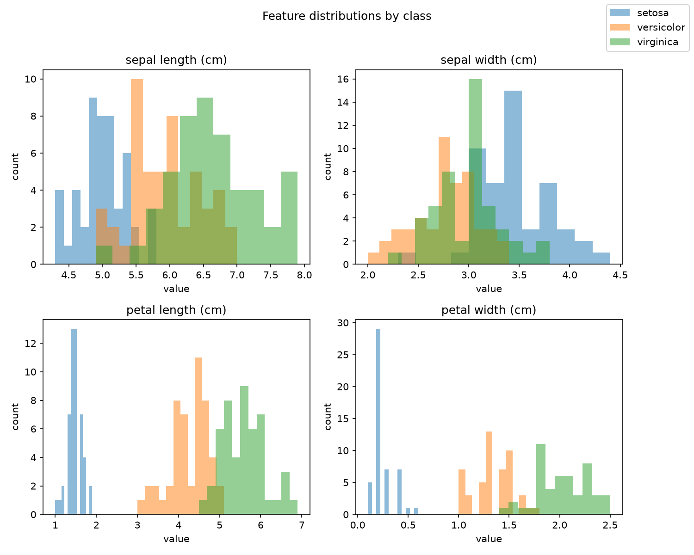
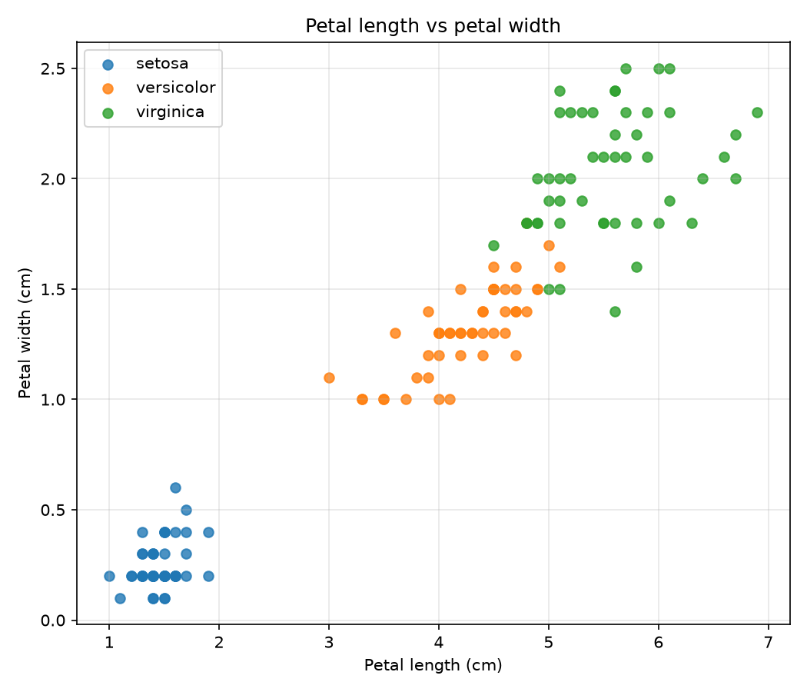
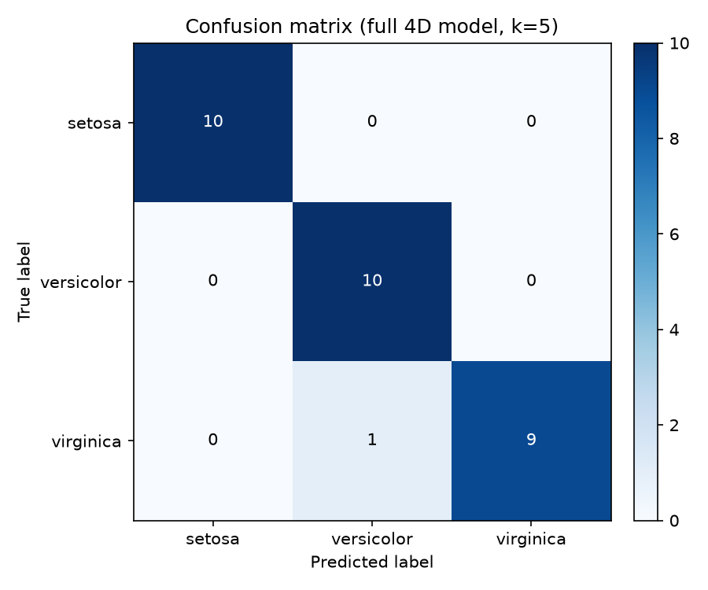
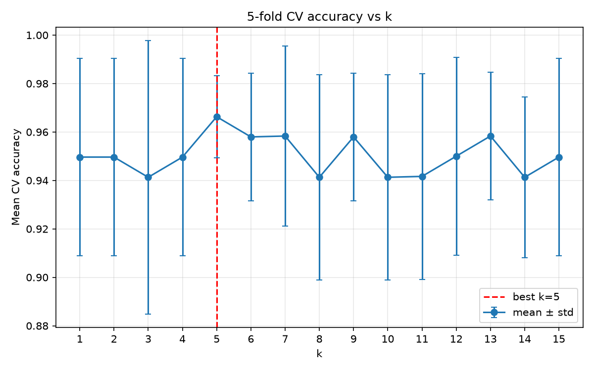
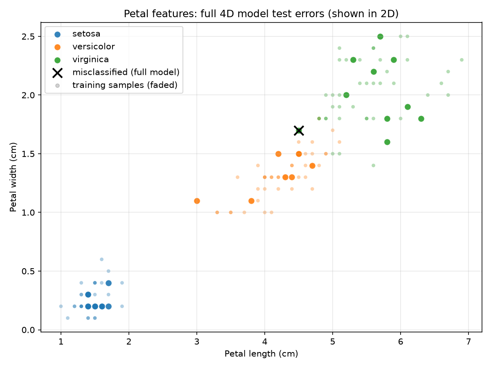
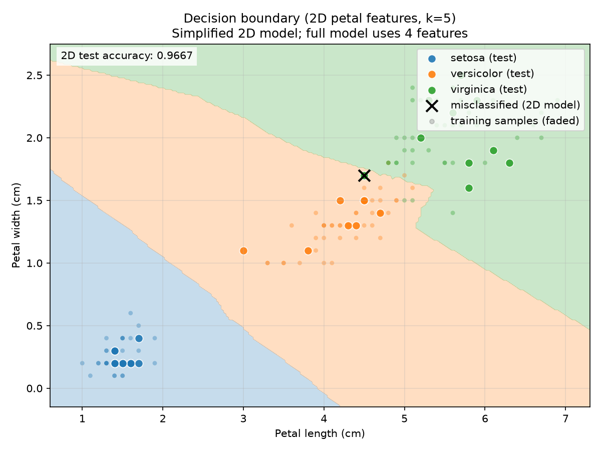

# 第 8 周实践一：KNN 算法手写实现与实验报告

- 姓名：林浩
- 专业：车辆工程
- 学号：__________
- 日期：2026 年 10 月

## 摘要

本实践在不调用 `sklearn.neighbors` 核心功能的前提下，用 Python 从零实现 KNN 分类与回归，并在 Iris 数据集上完成数据探索、预处理、距离计算、最近邻搜索、模型评估、k 值选择、可视化、sklearn 对照、异常处理和性能测试。

主要结果：

- 分类：k=5 时测试集准确率 **0.9667（29/30）**
- k 值选择：分层 5 折交叉验证选择 **k=5**，平均准确率 0.9663，标准差 0.0169
- 回归：以花瓣宽度为目标，k=5 均值预测 MAE **0.1620 cm**，RMSE 0.2165 cm
- sklearn 对照：分类预测 **30/30 完全一致**
- 性能：向量化距离计算比 Python 双重循环快约 **190 倍**
- 测试：**53 个单元测试全部通过**

## 1. 项目概述

本实践的目标是理解 KNN 的完整流程，而不是直接调用现成模型。具体包括：

1. 建立规范的项目目录和代码结构，固定随机种子，保证结果可复现。
2. 用 pandas 读取 Iris 数据，完成规模、类别分布、缺失值和重复值检查。
3. 按类别分层划分训练集和测试集，实现 Z-score 标准化，避免测试集信息泄漏。
4. 手写欧氏距离、曼哈顿距离、最近邻搜索、多数投票和 KNN 回归。
5. 实现准确率、混淆矩阵、precision、recall、F1 等评估指标。
6. 用分层 5 折交叉验证选择 k，绘制 k-准确率曲线。
7. 用 sklearn 的 `KNeighborsClassifier` 做同条件对照。
8. 处理常见异常，比较循环版和向量化版距离计算的耗时。
9. 完成单元测试、实验记录、可视化图表和本报告。

## 2. 运行环境与复现方式

### 2.1 运行环境

| 项目 | 版本 |
|---|---|
| Python | 3.11.17 |
| numpy | 2.4.6 |
| pandas | 3.0.6 |
| matplotlib | 3.11.2 |
| scikit-learn | 1.9.1 |
| conda | 26.7.2 |
| git | 2.56.0 |

使用的是 Anaconda 环境 `ai_ml`，解释器路径：

```text
E:\annaconda1\envs\ai_ml\python.exe
```

### 2.2 一键运行

在项目根目录执行：

```powershell
& "E:\annaconda1\envs\ai_ml\python.exe" main.py
```

运行全部测试：

```powershell
& "E:\annaconda1\envs\ai_ml\python.exe" -m unittest discover -v
```

### 2.3 复现约定

- 全项目统一随机种子：`42`
- 数据划分、交叉验证、性能测试的数据生成都使用该种子
- 标准化参数只由训练集计算，测试集只做 `transform`
- 所有实验结果保存到 `outputs/metrics/`，所有图表保存到 `outputs/figures/`

## 3. 数据说明与探索

### 3.1 数据规模

| 项目 | 数值 |
|---|---|
| 原始样本数 | 150 |
| 特征数 | 4 |
| 列名 | 花萼长度、花萼宽度、花瓣长度、花瓣宽度、类别 |
| 类别数 | 3 |
| 缺失值 | 0 |
| 重复样本 | 1 条 |

重复样本属于 virginica，四个特征为 5.8 / 2.7 / 5.1 / 1.9。去重后使用 **149 条**，避免同一朵花同时进入训练集和测试集。

### 3.2 类别分布

| 类别 | 原始数量 | 去重后数量 |
|---|---:|---:|
| setosa | 50 | 50 |
| versicolor | 50 | 50 |
| virginica | 50 | 49 |

### 3.3 特征统计

| 特征 | 最小值 | 均值 | 最大值 | 标准差 |
|---|---:|---:|---:|---:|
| 花萼长度 | 4.30 | 5.84 | 7.90 | 0.83 |
| 花萼宽度 | 2.00 | 3.06 | 4.40 | 0.44 |
| 花瓣长度 | 1.00 | 3.75 | 6.90 | 1.77 |
| 花瓣宽度 | 0.10 | 1.19 | 2.50 | 0.76 |

### 3.4 探索结论

- 四个特征量纲差异明显，花瓣长度标准差约 1.77，花萼宽度只有约 0.44。
- 花瓣长度、花瓣宽度的类别区分能力最强。
- setosa 仅凭花瓣特征就能与另外两类分开。
- versicolor 和 virginica 在花瓣特征上有少量重叠，是后续分类的主要误差来源。





## 4. 算法原理与实现

### 4.1 KNN 分类流程

1. 对训练集和测试集做同样的标准化。
2. 计算每个测试样本到所有训练样本的距离。
3. 按距离升序排序，取前 k 个训练样本作为邻居。
4. 统计 k 个邻居的类别票数。
5. 票数最多的类别作为预测结果。
6. 如果出现平票，选择距离最近的那个邻居所属的类别。

### 4.2 KNN 回归流程

1. 对输入特征做标准化，目标值保持原始单位。
2. 找到 k 个最近邻。
3. 均值预测：对 k 个邻居的目标值取平均。
4. 距离加权预测：权重为 `1 / (距离 + 1e-12)`，越近的邻居权重越大。

### 4.3 距离函数

欧氏距离：

```text
d(x, y) = sqrt(sum((x_i - y_i)^2))
```

曼哈顿距离：

```text
d(x, y) = sum(|x_i - y_i|)
```

矩阵版本使用 NumPy 广播：

```text
diff = X[:, None, :] - Y[None, :, :]
```

一次计算所有样本对的距离，避免 Python 双重循环。

### 4.4 标准化

Z-score 标准化：

```text
z = (x - mean) / std
```

均值和标准差只由训练集计算。测试集只调用 `transform()`，不参与参数计算。这样测试集的信息不会提前进入模型，避免信息泄漏。

本次训练集标准化参数：

| 特征 | 均值 | 标准差 |
|---|---:|---:|
| 花萼长度 | 5.8345 | 0.8300 |
| 花萼宽度 | 3.0697 | 0.4413 |
| 花瓣长度 | 3.7378 | 1.7648 |
| 花瓣宽度 | 1.1916 | 0.7610 |

标准化后训练集四个特征的均值都是 0、标准差都是 1；测试集均值不是 0，例如花萼宽度为 -0.1127，说明测试集只做了变换，没有参与参数计算。

### 4.5 平票处理

多数投票可能出现两个或多个类别票数相同。本项目采用规则：

> 票数相同时，选择距离最近的那个邻居所属的类别。

如果距离也完全相同，则按邻居在训练集中的索引顺序稳定选择。这样结果确定、可复现。

## 5. 实验设置

### 5.1 数据划分

| 数据 | 样本数 | setosa | versicolor | virginica |
|---|---:|---:|---:|---:|
| 训练集 | 119 | 40 | 40 | 39 |
| 测试集 | 30 | 10 | 10 | 10 |

采用按类别分层划分，80% 训练、20% 测试，随机种子 42。

### 5.2 评估指标

- 准确率：预测正确的样本数 / 总样本数
- precision：预测为某类的样本中，真正属于该类的比例
- recall：真实属于某类的样本中，被正确找出的比例
- F1：precision 和 recall 的调和平均
- MAE：回归预测值与真实值绝对误差的平均
- RMSE：回归预测误差平方平均后再开方

### 5.3 k 值选择

在训练集内部做分层 5 折交叉验证，k 从 1 到 15。每一折内部重新拟合标准化器，验证折只做 `transform`。测试集不参与 k 的选择。

## 6. 实验结果与分析

### 6.1 分类基线（k=5）

- 测试集准确率：**0.9667（29/30）**

混淆矩阵：

| 真实\预测 | setosa | versicolor | virginica |
|---|---:|---:|---:|
| setosa | 10 | 0 | 0 |
| versicolor | 0 | 10 | 0 |
| virginica | 0 | 1 | 9 |

每类指标：

| 类别 | precision | recall | F1 | support |
|---|---:|---:|---:|---:|
| setosa | 1.0000 | 1.0000 | 1.0000 | 10 |
| versicolor | 0.9091 | 1.0000 | 0.9524 | 10 |
| virginica | 1.0000 | 0.9000 | 0.9474 | 10 |
| 宏平均 | 0.9697 | 0.9667 | 0.9666 | 30 |

唯一错误：1 个 virginica 被判成 versicolor。这个错误与数据探索的结论一致：两类在花瓣特征上有重叠。该错误使 virginica 的 recall 降为 0.9，同时使 versicolor 的 precision 降为 0.9091。



### 6.2 k 值选择

5 折交叉验证结果：

| k | 平均准确率 | 标准差 |
|---:|---:|---:|
| 1 | 0.9496 | 0.0408 |
| 2 | 0.9496 | 0.0408 |
| 3 | 0.9413 | 0.0564 |
| 4 | 0.9496 | 0.0408 |
| **5** | **0.9663** | **0.0169** |
| 6 | 0.9580 | 0.0264 |
| 7 | 0.9583 | 0.0373 |
| 8 | 0.9413 | 0.0424 |
| 9 | 0.9580 | 0.0264 |
| 10 | 0.9413 | 0.0424 |
| 11 | 0.9417 | 0.0425 |
| 12 | 0.9500 | 0.0408 |
| 13 | 0.9583 | 0.0264 |
| 14 | 0.9413 | 0.0332 |
| 15 | 0.9496 | 0.0408 |

选择 **k=5**，理由：

- 平均准确率最高：0.9663
- 标准差较小：0.0169，说明不同折之间波动较小
- k=5 是奇数，二分类投票时更不容易平票

用 k=5 在测试集上做最终评估，准确率仍为 0.9667（29/30）。



### 6.3 KNN 回归结果

回归任务：用花萼长度、花萼宽度、花瓣长度预测花瓣宽度，单位 cm。训练/测试划分与分类完全一致。

k=5 时：

| 方法 | MAE | RMSE |
|---|---:|---:|
| 均值预测 | 0.1620 cm | 0.2165 cm |
| 距离加权预测 | 0.1622 cm | 0.2138 cm |

前 5 个测试样本：

| 真实值 | 均值预测 | 距离加权预测 |
|---:|---:|---:|
| 1.3 | 1.38 | 1.3734 |
| 1.6 | 2.08 | 2.0806 |
| 1.5 | 1.42 | 1.4156 |
| 0.3 | 0.16 | 0.1000 |
| 1.8 | 1.76 | 1.7635 |

花瓣宽度范围是 0.1 到 2.5 cm，平均约 1.19 cm，MAE 约 0.16 cm，预测结果整体合理。两种方法误差接近，距离加权的 RMSE 略低，说明远处邻居的干扰有所减少。

与 sklearn 的 `KNeighborsRegressor` 对照时，30 个测试样本中 29 个一致。唯一差异来自第 5 个邻居距离完全相同（0.330778）但目标值不同：手写实现按训练集索引选到 0.4，预测 0.34；sklearn 选到 0.2，预测 0.30；真实值 0.2。这是并列邻居选择规则不同，不是实现错误。

### 6.4 sklearn 分类对照

使用 `KNeighborsClassifier(n_neighbors=5, metric="euclidean")`，相同划分、相同标准化数据、相同 k：

| 项目 | 手写实现 | sklearn |
|---|---:|---:|
| 测试集准确率 | 0.9667 | 0.9667 |
| 逐样本预测差异 | 0 / 30 | 0 / 30 |

两者逐样本预测完全一致，说明手写的距离计算、最近邻搜索和投票逻辑正确。

### 6.5 参数影响

测试集（30 条）结果：

| 设置 | 准确率 |
|---|---:|
| 欧氏 + 标准化 | 0.9667 |
| 曼哈顿 + 标准化 | 0.9667 |
| 欧氏 + 未标准化 | 0.9667 |

30 条测试样本的准确率分辨率约为 0.033，三种设置都只错 1 个，单次测试集看不出差异。

5 折交叉验证（训练集 119 条）：

| 设置 | 平均准确率 ± 标准差 |
|---|---:|
| 欧氏 + 标准化 | 0.9663 ± 0.0169 |
| 欧氏 + 未标准化 | 0.9750 ± 0.0204 |
| 曼哈顿 + 标准化 | 0.9413 ± 0.0332 |
| 曼哈顿 + 未标准化 | 0.9496 ± 0.0165 |

分析：

- 在本数据上，欧氏距离优于曼哈顿距离。
- 未标准化欧氏的交叉验证平均准确率略高，原因是 Iris 中数值范围较大的花瓣特征本身也是最有区分度的特征，标准化会削弱它们的权重。
- 这并不说明标准化没有意义。标准化的作用是让距离不受量纲影响，换到特征尺度差异更大的数据集时更稳健。本项目主实验仍使用标准化数据，以保证流程规范。
- 数据只有 119 条训练样本，约 0.01 的差异只相当于一条样本，不能过度解读。

### 6.6 异常处理

| 场景 | 异常提示 |
|---|---|
| 空训练集 | 训练集不能为空 |
| 特征数不一致 | 特征数不一致：训练集有 4 个特征，预测数据有 3 个特征 |
| k 大于训练样本数 | k 不能大于训练样本数：k=1000, 训练样本数=119 |
| k<=0 | k 必须是正整数 |
| 非法距离度量 | metric 必须是 'euclidean' 或 'manhattan' |
| 空预测数据 | 预测数据不能为空 |
| 长度不一致 | X 和 y 的样本数不一致：119 != 118 |
| 平票但缺少距离 | 出现平票时必须提供 distances，按最近邻距离打破平票 |

8 个场景全部按预期报错，提示信息清晰。

### 6.7 性能对比

4 个特征，重复 3 次取平均：

| 数据规模 | 循环版 | 向量化版 | 加速 |
|---|---:|---:|---:|
| 100 x 100 | 136.52 ms | 0.71 ms | 192.5 倍 |
| 300 x 150 | 638.22 ms | 3.26 ms | 195.8 倍 |
| 500 x 250 | 1467.08 ms | 7.37 ms | 199.0 倍 |

具体耗时会随机器和运行状态波动，但趋势稳定：向量化版快约 190 倍。原因是循环版在 Python 层逐对样本计算，解释器开销大；向量化版用 NumPy 广播，把循环交给底层 C 实现。

## 7. 可视化分析

### 7.1 误分类散点图



图中按真实类别着色，小点是训练样本，大点是测试样本。黑色叉号标出完整 4 维模型的误分类样本，共 1 个，位于花瓣长度约 4.4、花瓣宽度约 1.7 的位置，真实类别为 virginica，被判成 versicolor。

### 7.2 决策边界



决策边界图用花瓣长度和花瓣宽度训练二维 KNN（k=5），背景颜色表示预测区域。二维模型测试集准确率也是 0.9667，但这只是当前测试集上的结果。二维模型只用于可视化，完整模型使用 4 个特征，模型评估以完整模型为准。

### 7.3 混淆矩阵热力图


热力图直观显示：setosa 和 versicolor 的对角线都是 10，virginica 对角线是 9，另外 1 个 virginica 被判成 versicolor。

## 8. 测试与复现

测试命令：

```powershell
& "E:\annaconda1\envs\ai_ml\python.exe" -m unittest discover -v
```

测试结果：

```text
Ran 53 tests in 0.602s
OK
```

53 个测试覆盖：

- 欧氏距离、曼哈顿距离、矩阵计算、循环版与向量化版一致性
- 最近邻排序、k 越界、维度不一致
- 多数投票、平票处理、分类器 fit/predict
- 回归均值、距离加权、完全重合点
- 准确率、混淆矩阵、分类报告
- 分层划分、分层 k 折、交叉验证
- 空数据、非法参数等异常场景

测试记录：`outputs/metrics/test_results.txt`。

## 9. 问题与改进

### 9.1 遇到的问题

1. **重复样本**：Iris 中有 1 条完全重复的 virginica。若不去重，同一朵花可能同时出现在训练集和测试集，导致评估偏乐观。已去重并在报告中记录。
2. **类别重叠**：versicolor 和 virginica 在花瓣特征上有重叠，测试集唯一错误就来自这里。
3. **平票和并列邻居**：回归对照时出现第 5 个邻居距离完全相同、目标值不同的情况。手写实现与 sklearn 选择了不同的并列邻居，导致 1 个样本预测不同。已在报告中说明。
4. **二维可视化的局限**：完整模型使用 4 个特征，决策边界只能画二维。二维模型只用于展示，不能替代完整模型评估。
5. **标准化没有提升本数据准确率**：交叉验证中未标准化欧氏略高。这说明标准化不是“必然涨点”，而是保证距离不受量纲影响；换数据集时更稳健。

### 9.2 可改进方向

- 增加数据量或使用更多数据集，降低小样本带来的波动。
- 尝试距离加权投票、特征加权或特征选择。
- 用嵌套交叉验证同时评估“选 k”和“模型评估”，进一步减少乐观偏差。
- 对高维数据使用 KD-Tree、Ball-Tree 或近似最近邻，降低搜索成本。
- 增加更多异常场景和边界测试，例如 NaN、无穷大、单类别数据。
- 按老师要求补充云端 git 仓库（当前按约定只做本地 git）。

## 10. git 管理

项目使用本地 git 分步提交：

| 提交 | 内容 |
|---|---|
| `9b1bf96` | 初始化项目骨架 |
| `1c418c9` | 数据读取与探索 |
| `7bd25b5` | 分层划分与 Z-score 标准化 |
| `d681cb1` | 距离函数与最近邻搜索 |
| `3ef1196` | KNN 分类器与多数投票 |
| `1c78952` | KNN 回归与距离加权预测 |
| `8c92789` | 模型评估与 k 值交叉验证选择 |
| `82dc4a7` | 二维散点、决策边界与混淆矩阵可视化 |
| `f9d5982` | sklearn 对照、异常检查与性能优化 |

后续测试记录与报告会作为新的提交加入。当前没有配置云端 remote；如果老师要求 GitHub/Gitee，可以在现有历史基础上直接添加 remote 并推送。

常用命令：

```powershell
git log --oneline
git status
```

## 11. 答辩要点

1. **为什么选 KNN？**
   KNN 不需要训练参数，原理直观，适合理解“距离—邻居—投票”的完整流程。

2. **为什么标准化只用训练集？**
   测试集如果参与均值和标准差计算，等于提前使用测试信息，属于信息泄漏。测试集只能 `transform`。

3. **为什么分层划分？**
   三类样本数量接近，分层能保证训练集和测试集的类别比例稳定，避免某一类在测试集中过少。

4. **为什么 k=5？**
   5 折交叉验证中 k=5 平均准确率最高（0.9663），标准差较小（0.0169），且是奇数，减少平票。

5. **为什么只有 1 个错误？**
   错误样本是 virginica，被判成 versicolor。两类在花瓣特征上有重叠，这是数据本身的特点，不是代码错误。

6. **二维模型准确率和四维一样，能说明二维更好吗？**
   不能。30 条测试样本分辨率有限，二维模型只是可视化简化，完整模型使用 4 个特征，评估以完整模型为准。

7. **手写实现和 sklearn 一致吗？**
   分类完全一致（30/30）。回归有 1 个样本不同，原因是第 5 个邻居距离完全相同但目标值不同，属于并列邻居选择差异。

8. **向量化为什么快？**
   循环版在 Python 层逐对计算，解释器开销大；向量化版用 NumPy 广播，把双重循环交给底层 C 实现，本次测试快约 190 倍。

## 附录：主要文件

| 文件 | 说明 |
|---|---|
| `knn.py` | 手写 KNN 核心实现 |
| `main.py` | 数据读取、实验流程、评估、可视化 |
| `test_knn.py` | 53 个单元测试 |
| `README.md` | 环境、目录、运行与复现说明 |
| `data/iris_dataset.csv` | Iris 数据集 |
| `outputs/figures/` | 所有图表 |
| `outputs/metrics/` | 所有实验记录与指标 |
| `report.md` | 本报告 |
